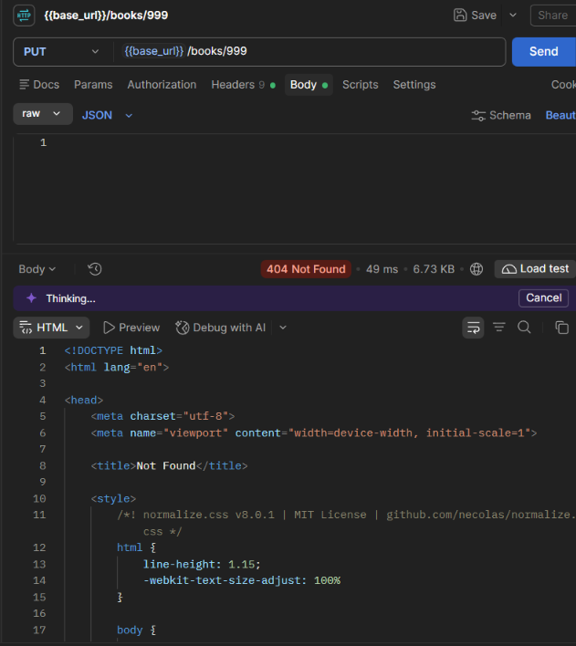
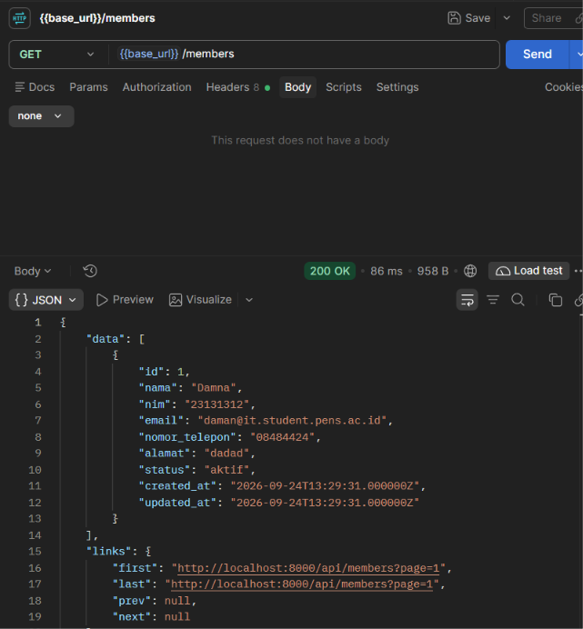
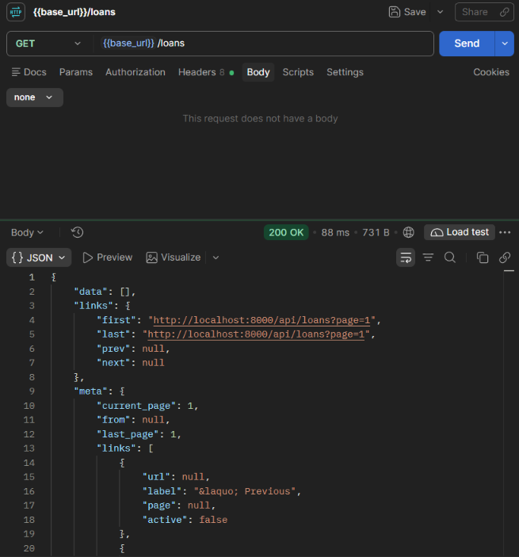
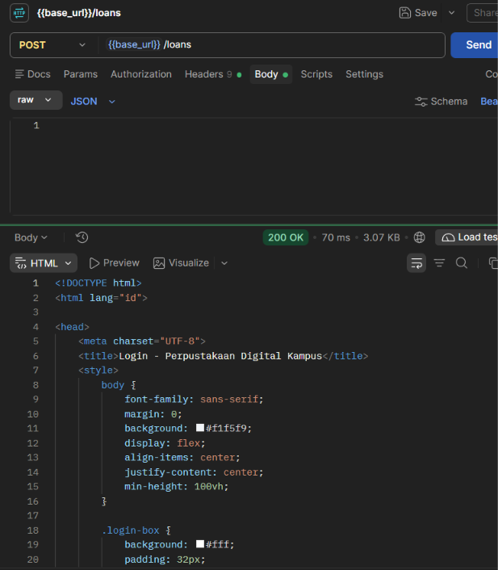
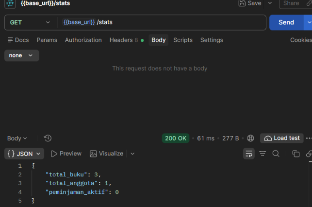

# Dokumentasi Endpoint REST API - Perpustakaan Digital Kampus

Dokumentasi ini mencakup 11 endpoint REST API yang dibangun pada **Pertemuan 9** (`books`, `members`, `loans`, dan `stats`). Seluruh response di bawah ini merupakan response nyata (*real output*) yang dihasilkan oleh aplikasi menggunakan API Resource Laravel.

> **Base URL:** `http://127.0.0.1:8000/api`  
> **Headers Wajib:** `Accept: application/json`

---

## 1. Tabel Ringkasan Seluruh Endpoint (11 Endpoint)

| No | Resource | Method | Endpoint URL | Body (JSON) | Status Code | Keterangan |
|:--:|:---|:---:|:---|:---|:---:|:---|
| 1 | Books | `GET` | `/api/books` | - | `200 OK` | Daftar buku terpaginasi (mendukung query `?judul=` & `?category_id=`) |
| 2 | Books | `GET` | `/api/books/{id}` | - | `200 OK` / `404 Not Found` | Detail data buku berdasarkan ID |
| 3 | Books | `POST` | `/api/books` | Data buku baru | `201 Created` / `422 Unprocessable` | Menambahkan buku baru ke sistem |
| 4 | Books | `PUT` | `/api/books/{id}` | Data buku diperbarui | `200 OK` / `422 Unprocessable` / `404 Not Found` | Memperbarui data buku berdasarkan ID |
| 5 | Books | `DELETE` | `/api/books/{id}` | - | `200 OK` / `404 Not Found` | Menghapus buku dari sistem |
| 6 | Members | `GET` | `/api/members` | - | `200 OK` | Daftar anggota terpaginasi |
| 7 | Members | `GET` | `/api/members/{id}` | - | `200 OK` / `404 Not Found` | Detail data anggota berdasarkan ID |
| 8 | Loans | `GET` | `/api/loans` | - | `200 OK` | Daftar transaksi peminjaman terpaginasi |
| 9 | Loans | `POST` | `/api/loans` | Data peminjaman | `201 Created` / `422 Unprocessable` | Mencatat transaksi peminjaman baru |
| 10 | Loans | `PUT` | `/api/loans/{id}/kembalikan` | - | `200 OK` / `404 Not Found` | Memproses pengembalian buku |
| 11 | Stats | `GET` | `/api/stats` | - | `200 OK` | Rekapitulasi angka statistik perpustakaan |

---

## 2. Detail Endpoint & Contoh Response Nyata

### 1. `GET /api/books`
Mengambil daftar buku dengan paginasi dan relasi kategori.

* **Method:** `GET`
* **URL:** `/api/books` (atau dengan filter: `/api/books?judul=Langitan`)
* **Headers:** `Accept: application/json`
* **Status:** `200 OK`
* **Response Body:**
```json
{
  "data": [
    {
      "id": 2,
      "judul": "Langitan",
      "penulis": "Daman",
      "penerbit": "Elexx",
      "tahun_terbit": 2020,
      "isbn": null,
      "stok": 2,
      "sampul": null,
      "category": {
        "id": 1,
        "nama_kategori": "Anak anak"
      },
      "created_at": "2026-10-06T01:51:59.000000Z",
      "updated_at": "2026-10-06T01:51:59.000000Z"
    }
  ],
  "links": {
    "first": "http://localhost:8000/api/books?page=1",
    "last": "http://localhost:8000/api/books?page=1",
    "prev": null,
    "next": null
  },
  "meta": {
    "current_page": 1,
    "from": 1,
    "last_page": 1,
    "path": "http://localhost:8000/api/books",
    "per_page": 10,
    "to": 1,
    "total": 1
  }
}
```

---

### 2. `GET /api/books/{id}`
Mengambil detail satu buku berdasarkan ID.

* **Method:** `GET`
* **URL:** `/api/books/2`
* **Status:** `200 OK` (Sukses)
```json
{
  "data": {
    "id": 2,
    "judul": "Langitan",
    "penulis": "Daman",
    "penerbit": "Elexx",
    "tahun_terbit": 2020,
    "isbn": null,
    "stok": 2,
    "sampul": null,
    "category": {
      "id": 1,
      "nama_kategori": "Anak anak"
    },
    "created_at": "2026-10-06T01:51:59.000000Z",
    "updated_at": "2026-10-06T01:51:59.000000Z"
  }
}
```

* **URL (Data Tidak Ditemukan):** `/api/books/999`
* **Status:** `404 Not Found` (Gagal)
```json
{
  "message": "No query results for model [App\\Models\\Book] 999"
}
```

---

### 3. `POST /api/books`
Menambahkan buku baru.

* **Method:** `POST`
* **URL:** `/api/books`
* **Headers:** `Accept: application/json`, `Content-Type: application/json`
* **Body Request:**
```json
{
  "judul": "Pemrograman Web Modern",
  "penulis": "Budi Santoso",
  "penerbit": "Informatika",
  "tahun_terbit": 2024,
  "isbn": "978-602-1234-99-9",
  "stok": 5,
  "category_id": 1
}
```
* **Status:** `201 Created` (Sukses)
```json
{
  "data": {
    "id": 5,
    "judul": "Pemrograman Web Modern",
    "penulis": "Budi Santoso",
    "penerbit": "Informatika",
    "tahun_terbit": 2024,
    "isbn": "978-602-1234-99-9",
    "stok": 5,
    "sampul": null,
    "category": {
      "id": 1,
      "nama_kategori": "Anak anak"
    },
    "created_at": "2026-11-03T06:51:30.000000Z",
    "updated_at": "2026-11-03T06:51:30.000000Z"
  }
}
```

* **Body Request (Kosong / Tidak Valid):** `{}`
* **Status:** `422 Unprocessable Entity` (Gagal Validasi)
```json
{
  "message": "Field judul wajib diisi. (and 5 more errors)",
  "errors": {
    "judul": ["Field judul wajib diisi."],
    "penulis": ["Field penulis wajib diisi."],
    "penerbit": ["Field penerbit wajib diisi."],
    "tahun_terbit": ["Field tahun terbit wajib diisi."],
    "stok": ["Field stok wajib diisi."],
    "category_id": ["Field kategori wajib diisi."]
  }
}
```

---

### 4. `PUT /api/books/{id}`
Memperbarui data buku.

* **Method:** `PUT`
* **URL:** `/api/books/2`
* **Body Request:**
```json
{
  "judul": "Langitan (Edisi Revisi)",
  "penulis": "Daman",
  "penerbit": "Elexx",
  "tahun_terbit": 2021,
  "isbn": "978-602-000-111-2",
  "stok": 12,
  "category_id": 1
}
```
* **Status:** `200 OK` (Sukses)
```json
{
  "data": {
    "id": 2,
    "judul": "Langitan (Edisi Revisi)",
    "penulis": "Daman",
    "penerbit": "Elexx",
    "tahun_terbit": 2021,
    "isbn": "978-602-000-111-2",
    "stok": 12,
    "sampul": null,
    "category": {
      "id": 1,
      "nama_kategori": "Anak anak"
    },
    "created_at": "2026-10-06T01:51:59.000000Z",
    "updated_at": "2026-11-03T06:55:00.000000Z"
  }
}
```

* **URL (ID Tidak Ditemukan):** `/api/books/999`
* **Status:** `404 Not Found` (Gagal)


---

### 5. `DELETE /api/books/{id}`
Menghapus buku berdasarkan ID.

* **Method:** `DELETE`
* **URL:** `/api/books/5`
* **Status:** `200 OK` (Sukses)
```json
{
  "message": "Buku berhasil dihapus."
}
```

* **URL (Jika ID tidak ada):** `/api/books/999`
* **Status:** `404 Not Found` (Gagal)
```json
{
  "message": "No query results for model [App\\Models\\Book] 999"
}
```

---

### 6. `GET /api/members`
Mengambil daftar anggota perpustakaan.

* **Method:** `GET`
* **URL:** `/api/members`
* **Status:** `200 OK` (Sukses)
* **Dokumentasi Postman:**


* **Response Body:**
```json
{
  "data": [
    {
      "id": 1,
      "nama": "Damna",
      "nim": "23131312",
      "email": "daman@it.student.pens.ac.id",
      "nomor_telepon": "08484424",
      "alamat": "dadad",
      "status": "aktif",
      "created_at": "2026-09-24T13:29:31.000000Z",
      "updated_at": "2026-09-24T13:29:31.000000Z"
    }
  ],
  "links": {
    "first": "http://localhost:8000/api/members?page=1",
    "last": "http://localhost:8000/api/members?page=1",
    "prev": null,
    "next": null
  }
}
```

---

### 7. `GET /api/members/{id}`
Mengambil detail anggota berdasarkan ID.

* **Method:** `GET`
* **URL:** `/api/members/1`
* **Status:** `200 OK` (Sukses)
```json
{
  "data": {
    "id": 1,
    "nama": "Damna",
    "nim": "23131312",
    "email": "daman@it.student.pens.ac.id",
    "nomor_telepon": "08484424",
    "alamat": "dadad",
    "status": "aktif",
    "created_at": "2026-09-24T13:29:31.000000Z",
    "updated_at": "2026-09-24T13:29:31.000000Z"
  }
}
```

* **URL (ID Tidak Ditemukan):** `/api/members/999`
* **Status:** `404 Not Found` (Gagal)
```json
{
  "message": "No query results for model [App\\Models\\Member] 999"
}
```

---

### 8. `GET /api/loans`
Mengambil daftar seluruh transaksi peminjaman buku beserta eager load relasi `member`, `user` (petugas), dan `loanItems.book`.

* **Method:** `GET`
* **URL:** `/api/loans`
* **Status:** `200 OK` (Sukses)
* **Dokumentasi Postman:**


* **Response Body:**
```json
{
  "data": [
    {
      "id": 1,
      "member": {
        "id": 1,
        "nama": "Damna"
      },
      "petugas": {
        "id": 1,
        "name": "Admin Perpustakaan"
      },
      "tanggal_pinjam": "2026-11-03",
      "tanggal_kembali": "2026-11-10",
      "tanggal_dikembalikan": null,
      "status": "dipinjam",
      "books": [
        {
          "id": 2,
          "judul": "Langitan"
        }
      ]
    }
  ],
  "links": {
    "first": "http://localhost:8000/api/loans?page=1",
    "last": "http://localhost:8000/api/loans?page=1",
    "prev": null,
    "next": null
  },
  "meta": {
    "current_page": 1,
    "from": 1,
    "last_page": 1,
    "total": 1
  }
}
```

---

### 9. `POST /api/loans`
Mencatat transaksi peminjaman baru.

* **Method:** `POST`
* **URL:** `/api/loans`
* **Headers:** `Accept: application/json`, `Content-Type: application/json`
* **Body Request:**
```json
{
  "member_id": 1,
  "user_id": 1,
  "tanggal_pinjam": "2026-11-03",
  "tanggal_kembali": "2026-11-10",
  "book_ids": [2]
}
```
* **Status:** `201 Created` (Sukses)
```json
{
  "data": {
    "id": 1,
    "member": {
      "id": 1,
      "nama": "Damna"
    },
    "petugas": {
      "id": 1,
      "name": "Admin Perpustakaan"
    },
    "tanggal_pinjam": "2026-11-03",
    "tanggal_kembali": "2026-11-10",
    "tanggal_dikembalikan": null,
    "status": "dipinjam",
    "books": [
      {
        "id": 2,
        "judul": "Langitan"
      }
    ]
  }
}
```

* **Body Request (Kosong / Uji Validasi):** `{}`
* **Status:** `422 Unprocessable Entity` (Gagal Validasi)
```json
{
  "message": "Anggota wajib dipilih. (and 4 more errors)",
  "errors": {
    "member_id": ["Anggota wajib dipilih."],
    "user_id": ["Petugas (user_id) wajib diisi."],
    "tanggal_pinjam": ["Tanggal pinjam wajib diisi."],
    "tanggal_kembali": ["Tanggal kembali wajib diisi."],
    "book_ids": ["Pilih minimal satu buku."]
  }
}
```

> **Catatan Pengujian Postman:**  
> Jika header `Accept: application/json` tidak disertakan saat mengirim request `POST` kosong ke route web yang terproteksi CSRF/session, server akan mengarahkan response ke halaman login HTML:  
>   
> *Solusi:* Pastikan header `Accept: application/json` diaktifkan dan endpoint mengarah ke `/api/loans`.

---

### 10. `PUT /api/loans/{id}/kembalikan`
Memproses pengembalian buku peminjaman.

* **Method:** `PUT`
* **URL:** `/api/loans/1/kembalikan`
* **Status:** `200 OK` (Sukses)
```json
{
  "data": {
    "id": 1,
    "member": {
      "id": 1,
      "nama": "Damna"
    },
    "petugas": {
      "id": 1,
      "name": "Admin Perpustakaan"
    },
    "tanggal_pinjam": "2026-11-03",
    "tanggal_kembali": "2026-11-10",
    "tanggal_dikembalikan": "2026-11-03",
    "status": "dikembalikan",
    "books": [
      {
        "id": 2,
        "judul": "Langitan"
      }
    ]
  }
}
```

* **URL (ID Peminjaman Tidak Ada):** `/api/loans/999/kembalikan`
* **Status:** `404 Not Found` (Gagal)
```json
{
  "message": "No query results for model [App\\Models\\Loan] 999"
}
```

---

### 11. `GET /api/stats`
Menghasilkan ringkasan data statistik perpustakaan.

* **Method:** `GET`
* **URL:** `/api/stats`
* **Status:** `200 OK` (Sukses)
* **Dokumentasi Postman:**


* **Response Body:**
```json
{
  "total_buku": 3,
  "total_anggota": 1,
  "peminjaman_aktif": 0
}
```

